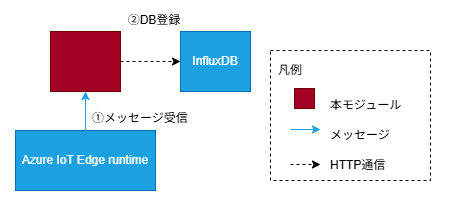
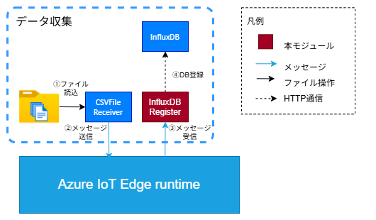
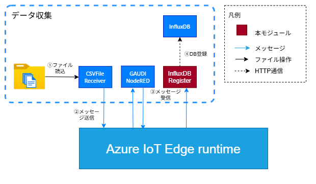

# InfluxDBRegister

## 目次
* [概要](#概要)
* [機能](#機能)
* [Quick Start](#quick-start)
* [イメージのURL](#イメージのurl)
* [動作保証環境](#動作保証環境)
* [Deployment 設定値](#deployment-設定値)
  * [環境変数](#環境変数)
  * [Desired Properties](#desired-properties)
  * [Create Option](#create-option)
  * [startupOrder](#startuporder)
* [受信メッセージ](#受信メッセージ)
  * [Message Body](#message-body)
  * [Message Properties](#message-properties)
* [送信メッセージ](#送信メッセージ)
* [Direct Method](#direct-method)
  * [SetLogLevel](#setloglevel)
  * [GetLogLevel](#getloglevel)
* [ログ出力内容](#ログ出力内容)
* [ユースケース](#ユースケース)
  * [ケース ①](#Usecase1)
  * [ケース ②](#Usecase2)
  * [ケース ③](#Usecase3)
* [Feedback](#feedback)
* [LICENSE](#license)

## 概要

InfluxDBRegisterは、入力されたメッセージをInfluxDBに格納するAzure IoT edgeモジュールです。

## 機能

受信したメッセージをInfluxDBに格納する。  
※ 本モジュールとInfluxDBを別ホスト上で構築する場合、ネットワークエラー時に受信メッセージがDBに登録されずメッセージが破棄される可能性があるため、同一ホスト上で使用することを推奨する。



## Quick Start
1. Personal Access tokenを作成
（参考: [個人用アクセス トークンを管理する](https://docs.github.com/ja/authentication/keeping-your-account-and-data-secure/managing-your-personal-access-tokens)）

2. リポジトリをクローン
```
git clone https://github.com/Project-GAUDI/InfluxDBRegister
```

3. ./src/nuget_template.configの<GITHUB_USERNAME>と<PERSONAL_ACCESS_TOKEN>を自身のユーザー名とPersonal Access tokenに書き換えて、ファイル名をnuget.configに変更してください

4. Dockerイメージをビルド
```
docker image build -t <IMAGE_NAME> ./InfluxDBRegister/src/
```
例）
```
docker image build -t ghcr.io/<YOUR_GITHUB_USERNAME>/influxdbregister:<VERSION> ./InfluxDBRegister/src/
```

5. Dockerイメージをコンテナレジストリにプッシュ
```
docker push <IMAGE_NAME>
```
例）
```
docker push ghcr.io/<YOUR_GITHUB_USERNAME>/influxdbregister:<VERSION>
```

6. Azure IoT edgeで利用

## イメージのURL
準備中

| URL                                                         | Description         |
| ----------------------------------------------------------- | ------------------- |

## 動作保証環境

| Module Version | IoTEdge | edgeAgent | edgeHub | amd64 verified on | arm64v8 verified on | arm32v7 verified on |
| -------------- | ------- | --------- | ------- | ----------------- | ------------------- | ------------------- |
| 7.0.1          | 1.6.4   | 1.6.4     | 1.6.4   | ubuntu24.04       | －                  | －                  |

## Deployment 設定値

### 環境変数

#### 環境変数の値

| Key               | Type   | Required | Conditions                                  | Default | Description                             |
| ----------------- | ------ | -------- | ------------------------------------------- | ------- | --------------------------------------- |
| URI               | string | 〇       |                                             |         | HTTP リクエスト先の InfluxDB アドレス。 |
| DBName            | string | 〇       |                                             |         | データ格納を行う InfluxDB の DB 名。    |
| Interval          | number | 〇       | 0以上の整数                                 |         | InfluxDB の書き込み処理間隔(秒)。       |
| TransportProtocol | string |          | ["Amqp", "Mqtt"]                            | Amqp    | ModuleClient の接続プロトコル。         |
| LogLevel          | string |          | ["trace", "debug", "info", "warn", "error"] | info    | 出力ログレベル。                        |

### Desired Properties

#### Desired Properties の値

| JSON Key                      | Type    | Required | Conditions                                       | Default   | Description                                                                                                                                                                                                                                                                                |
| ----------------------------- | ------- | -------- | ------------------------------------------------ | --------- | ------------------------------------------------------------------------------------------------------------------------------------------------------------------------------------------------------------------------------------------------------------------------------------------ |
| dbparam[x]                    | object  | 〇       | [x]は1から始まる連番                             |           | 監視するメッセージ情報。                                                                                                                                                                                                                                                                   |
| &emsp; input                  | string  | 〇       |                                                  |           | 受信するメッセージのインプット名。                                                                                                                                                                                                                                                         |
| &emsp; measurement            | string  | 〇       |                                                  |           | InfluxDB の書き込み先テーブル名。                                                                                                                                                                                                                                                          |
| &emsp; use_header             | boolean | 〇       |                                                  |           | 受信するメッセージの RecordHeader 部の値使用可否。                                                                                                                                                                                                                                         |
| &emsp; use_data               | boolean | 〇       |                                                  |           | 受信するメッセージの RecordData 部の値使用可否。                                                                                                                                                                                                                                           |
| &emsp; set_usertimestamp      | boolean | 〇       |                                                  |           | false：ユーザタイムスタンプを指定しない。DB 挿入時の時刻をタイムスタンプとする。<br>true：ユーザタイムスタンプを指定する。timestamp_indexで指定されたインデックス位置のデータを用いて、タイムスタンプを設定する。 <br>eofメッセージを受信した場合はDB 挿入時の時刻をタイムスタンプとする。 |
| &emsp; timestamp_index        | number  | △        | set_usertimestamp=true時必須<br>1以上の整数      |           | ユーザタイムスタンプとして登録する入力データのインデックス（列番号：1～）を指定。<br>timestamp_indexがRecordDataの列数以下の場合、指定インデックスを使用。<br>範囲外の場合、受信メッセージは破棄される。                                                                                   |
| &emsp; field_data_type        | string  |          | ["automatic","string_all"]                       | automatic | 受信するメッセージの RecordData 部の保存タイプを指定する。<br>&emsp; "string_all"：全て文字列データとして保存<br>&emsp; "automatic"：自動決定。入力データの状態のまま保存する。動作は、InfluxDB の仕様に準じる。(※1)                                                                       |
| &emsp; tags                   | object  | 〇       |                                                  |           | InfluxDB に格納するタグ名称を列挙。                                                                                                                                                                                                                                                        |
| &emsp;&emsp; tag 設定方法 1   |         |          |                                                  |           |                                                                                                                                                                                                                                                                                            |
| &emsp;&emsp; tag[y]           | string  | 〇       | [y]は1から始まる連番                             |           | MessageProperty 名を指定。                                                                                                                                                                                                                                                                 |
| &emsp;&emsp; tag 設定方法 2   |         |          |                                                  |           |                                                                                                                                                                                                                                                                                            |
| &emsp;&emsp; tag[y]           | object  | 〇       | [y]は1から始まる連番                             |           | MessageProperty 名と行番号のセットを指定。                                                                                                                                                                                                                                                 |
| &emsp;&emsp;&emsp; tag_name   | string  | 〇       |                                                  |           | MessageProperty 名を指定。                                                                                                                                                                                                                                                                 |
| &emsp;&emsp;&emsp; value_type | string  | 〇       | ["MessageProperty","MessagePropertyAndRowIndex"] |           | MessageProperty：プロパティ値を出力<br>MessagePropertyAndRowIndex：プロパティ値に行番号を加算した値を出力                                                                                                                                                                                  |

※1 4.0.0-rc1以前から4.0.0-rc1以降に設定変更なしでモジュールを更新した場合、"string_all"設定から"automatic"設定に変更した状態となり、既存のstringカラムに非stringのデータを書き込みにいき、エラーになる可能性があるため、ご注意ください。

#### Desired Properties の記入例

```json
{
  "dbparam1": {
    "input": "cfrOut1",
    "measurement": "measurement1",
    "use_header": false,
    "use_data": true,
    "set_usertimestamp": true,
    "timestamp_index": 1,
    "field_data_type": "automatic",
    "tags": {
      "tag1": "col1",
      "tag2": {
        "tag_name": "col2",
        "value_type": "MessageProperty"
      }
    }
  }
}
```

### Create Option

#### Create Option の値

なし

#### Create Option の記入例

```json
{}
```

### startupOrder

#### startupOrder の値

| JSON Key     | Type   | Required | Conditions                   | Default    | Recommend | Description                                            |
| ------------ | ------ | -------- | ---------------------------- | ---------- | --------- | ------------------------------------------------------ |
| startupOrder | number |          | 0 以上 4294967295 以下の整数 | 4294967295 | 300       | モジュールの起動順序。数字が小さいほど先に起動される。 |

#### startupOrder の記入例

```json
{
  "startupOrder": 300
}
```

## 受信メッセージ

GAUDI標準形式メッセージを処理の対象とする。

### Message Body

任意

### Message Properties

任意

### Messageの例

```json
{
  "Body": {
    "RecordList": [
      {
        "RecordHeader":["example_sensor.xlsx","1"],
        "RecordData":["2021/07/15 11:00:00", "AAA", …, "10"]
      }
    ]
  },
  "Properties": {
    "filename":"example_sensor.xlsx",
    "row_number":1,
    "shot_count":1
  }
}
```

格納データ

| DB      | measurement | time                | 1                     | 2     | 3   | 4    | type | row_number | shot_count |
| ------- | ----------- | ------------------- | --------------------- | ----- | --- | ---- | ---- | ---------- | ---------- |
| example | sensor      | 2021/07/15 11:00:10 | "2021/07/15 11:00:00" | "AAA" | ... | "10" |      | 1          | 1          |

## 送信メッセージ

なし

## Direct Method

### SetLogLevel

* 機能概要

  実行中に一時的にLogLevelを変更する。<br>
  変更はモジュール起動中または有効時間を過ぎるまで有効。<br>

* payload

  | JSON Key      | Type    | Required | default | Description |
  | ------------- | ------- | -------- | -------- | ----------- |
  | EnableSec     | integer  | 〇       |          | 有効時間(秒)。<br>-1:無期限<br>0:リセット(環境変数LogLevel相当に戻る)<br>1以上：指定時間(秒)経過まで有効。  |
  | LogLevel      | string  | △       |          | EnableSec=0以外を指定時必須。指定したログレベルに変更する。<br>["trace", "debug", "info", "warn", "error"]  |

  １時間"trace"レベルに変更する場合の設定例

  ```json
  {
    "EnableSec": 3600,
    "LogLevel": "trace"
  }
  ```

* response

  | JSON Key      | Type    | Description |
  | ------------- | ------- | ----------- |
  | status          | integer | 処理ステータス。<br>0:正常終了<br>その他:異常終了         |
  | payload          | object  | レスポンスデータ。         |
  | &nbsp; CurrentLogLevel | string  | 設定後のログレベル。（正常時のみ）<br>["trace", "debug", "info", "warn", "error"]  |
  | &nbsp; Error | string  | エラーメッセージ（エラー時のみ）  |

  ```json
  {
    "status": 0,
    "paylaod":
    {
      "CurrentLogLevel": "trace"
    }
  }
  ```

### GetLogLevel

* 機能概要

  現在有効なLogLevelを取得する。<br>
  通常は、LogLevel環境変数の設定値が返り、SetLogLevelで設定した有効時間内の場合は、その設定値が返る。<br>

* payload

  なし

* response

  | JSON Key      | Type    | Description |
  | ------------- | ------- | ----------- |
  | status          | integer | 処理ステータス。<br>0:正常終了<br>その他:異常終了         |
  | payload          | object  | レスポンスデータ。         |
  | &nbsp; CurrentLogLevel | string  | 現在のログレベル。（正常時のみ）<br>["trace", "debug", "info", "warn", "error"]  |
  | &nbsp; Error | string  | エラーメッセージ（エラー時のみ）  |

  ```json
  {
    "status": 0,
    "paylaod":
    {
      "CurrentLogLevel": "trace"
    }
  }
  ```

## ログ出力内容

| LogLevel | 出力概要                                                                                                                                                                  |
| -------- | ------------------------------------------------------------------------------------------------------------------------------------------------------------------------- |
| error    | [初期化/リソース解放/モジュールツイン更新/メッセージ受信]失敗<br>[環境変数/モジュールツイン]の必須項目未設定<br>[環境変数/モジュールツイン]がConditionsまたはType制約違反 |
| warn     | エッジランタイムとの接続リトライ失敗                                                                                                                                      |
| info     | [環境変数/モジュールツイン]の値<br>モジュールツイン更新通知<br>[環境変数/モジュールツイン]の省略可能項目未設定のためDefault値適用<br>メッセージ受信通知                   |
| debug    | 無し                                                                                                                                                                      |
| trace    | リソース解放済み通知<br>メソッドの開始・終了<br>受信メッセージBody                                                                                                        |

## ユースケース

<a id="Usecase1"></a>

### ケース①

アップロードされるCSVファイルのデータを下記の条件で格納する。

* タイムスタンプには格納時の時刻を使用する。
* 受信メッセージBodyは全て文字列として格納する。



#### 起動順序 startupOrder

| 名称         | 値  |
| ------------ | --- |
| startupOrder | 300 |

#### 環境変数

| 名称              | 値                     |
| ----------------- | ---------------------- |
| URI               | `http://influxdb:8086` |
| DBName            | example                |
| Interval          | 2                      |
| TransportProtocol | Amqp                   |
| LogLevel          | debug                  |

#### コンテナーの作成オプション Create Option

```json
{}
```

#### モジュールツインの設定

```JSON
{
  "dbparam1": {
    "input": "input1",
    "measurement": "sensor",
    "use_header": false,
    "use_data": true,
    "set_usertimestamp": false,
    "field_data_type": "string_all",
    "tags": {
      "tag1": "type",
      "tag2": {
        "tag_name": "row_number",
        "value_type": "MessagePropertyAndRowIndex"
      },
      "tag3": "shot_count"
    }
  }
}

```

#### 入力内容

メッセージ1通目

```json
{
  "Body": {
    "RecordList": [
      {
        "RecordHeader":["example_sensor.xlsx","1"],
        "RecordData":["2021/07/15 11:00:00", "AAA", …, "10"]
      },
      {
        "RecordHeader":["example_sensor.xlsx","2"],
        "RecordData":["2021/07/15 11:00:03", "AAB", …, "10"]
      },
      {
        "RecordHeader":["example_sensor.xlsx","3"],
        "RecordData":["2021/07/15 11:00:05", "ABA", …, "10"]
      },
      {
        "RecordHeader":["example_sensor.xlsx","4"],
        "RecordData":["2021/07/15 11:00:09", "ABB", …, "10"]
      }
    ]
  },
  "Properties": {
    "filename":"example_sensor.xlsx",
    "row_number":1,
    "shot_count":1
  }
}
```

メッセージ2通目(eofメッセージ)

```json
{
  "Properties": {
    "filename":"example_sensor.xlsx",
    "type": "eof",
    "row_number":5,
    "shot_count":1
  }
}
```

#### 出力結果

InfluxDBのレコード

出力例: InfluxDBの格納データ

| DB      | measurement | time                | 1                     | 2     | 3    | 4    | type | row_number | shot_count |
| ------- | ----------- | ------------------- | --------------------- | ----- | ---- | ---- | ---- | ---------- | ---------- |
| example | sensor      | 2021/07/15 11:00:10 | "2021/07/15 11:00:00" | "AAA" | ...  | "10" |      | 1          | 1          |
|         |             | 2021/07/15 11:00:12 | "2021/07/15 11:00:03" | "AAB" | ...  | "10" |      | 2          | 1          |
|         |             | 2021/07/15 11:00:14 | "2021/07/15 11:00:05" | "ABA" | ...  | "10" |      | 3          | 1          |
|         |             | 2021/07/15 11:00:16 | "2021/07/15 11:00:09" | "ABB" | ...  | "10" |      | 4          | 1          |
|         |             | 2021/07/15 11:00:18 | None                  | None  | None | None | eof  | 5          | 1          |

<a id="Usecase2"></a>

### ケース②

GAUDINodeREDから受信した加工済みのCSVファイルデータを下記の条件で格納する。

* 格納タイムスタンプにはモジュールツインtimestamp_indexで設定した受信メッセージのインデックスを使用する。
* 受信メッセージBodyは型が保持されたまま格納する。



#### 起動順序 startupOrder

| 名称         | 値  |
| ------------ | --- |
| startupOrder | 300 |

#### 環境変数

| 名称              | 値                     |
| ----------------- | ---------------------- |
| URI               | `http://influxdb:8086` |
| DBName            | example                |
| Interval          | 2                      |
| TransportProtocol | Amqp                   |
| LogLevel          | debug                  |

#### コンテナーの作成オプション Create Option

```json
{}
```

#### モジュールツインの設定

```JSON
{
  "dbparam1": {
    "input": "input1",
    "measurement": "sensor",
    "use_header": false,
    "use_data": true,
    "set_usertimestamp": true,
    "timestamp_index": 1,
    "field_data_type": "automatic",
    "tags": {
      "tag1": "type",
      "tag2": {
        "tag_name": "row_number",
        "value_type": "MessagePropertyAndRowIndex"
      },
      "tag3": "shot_count"
    }
  }
}

```

#### 入力内容

メッセージ1通目

```json
{
  "Body": {
    "RecordList": [
      {
        "RecordHeader":["example_sensor.xlsx","1"],
        "RecordData":["2021/07/15 11:00:00", …, "10"]
      },
      {
        "RecordHeader":["example_sensor.xlsx","2"],
        "RecordData":["2021/07/15 11:00:03", …, "10"]
      },
      {
        "RecordHeader":["example_sensor.xlsx","3"],
        "RecordData":["2021/07/15 11:00:05", …, "10"]
      },
      {
        "RecordHeader":["example_sensor.xlsx","4"],
        "RecordData":["2021/07/15 11:00:09", …, "10"]
      }
    ]
  },
  "Properties": {
    "filename":"example_sensor.xlsx",
    "row_number":1,
    "shot_count":1
  }
}
```

メッセージ2通目(eofメッセージ)

```json
{
  "Properties": {
    "filename":"example_sensor.xlsx",
    "type": "eof",
    "row_number":5,
    "shot_count":1
  }
}
```

#### 出力結果

InfluxDBのレコード

出力例: InfluxDBの格納データ

| DB      | measurement | time                | 1                     | 2    | 3    | type | row_number | shot_count |
| ------- | ----------- | ------------------- | --------------------- | ---- | ---- | ---- | ---------- | ---------- |
| example | sensor      | 2021/07/15 11:00:00 | "2021/07/15 11:00:00" | ...  | 10   |      | 1          | 1          |
|         |             | 2021/07/15 11:00:03 | "2021/07/15 11:00:03" | ...  | 10   |      | 2          | 1          |
|         |             | 2021/07/15 11:00:05 | "2021/07/15 11:00:05" | ...  | 10   |      | 3          | 1          |
|         |             | 2021/07/15 11:00:09 | "2021/07/15 11:00:09" | ...  | 10   |      | 4          | 1          |
|         |             | 2021/07/15 11:00:14 | None                  | None | None | eof  | 5          | 1          |

<a id="Usecase3"></a>

### ケース③

アップロードされるCSVファイルのデータを下記の条件で格納する。

* 受信メッセージHeaderとBodyは全て文字列として格納する。


#### 起動順序 startupOrder

| 名称         | 値  |
| ------------ | --- |
| startupOrder | 300 |

#### 環境変数

| 名称              | 値                     |
| ----------------- | ---------------------- |
| URI               | `http://influxdb:8086` |
| DBName            | example                |
| Interval          | 2                      |
| TransportProtocol | Amqp                   |
| LogLevel          | debug                  |

#### コンテナーの作成オプション Create Option

```json
{}
```

#### モジュールツインの設定

```JSON
{
  "dbparam1": {
    "input": "input1",
    "measurement": "sensor",
    "use_header": true,
    "use_data": true,
    "set_usertimestamp": false,
    "field_data_type": "string_all",
    "tags": {
      "tag1": "type",
      "tag2": {
        "tag_name": "row_number",
        "value_type": "MessagePropertyAndRowIndex"
      },
      "tag3": "shot_count"
    }
  }
}

```

#### 入力内容

メッセージ1通目

```json
{
  "Body": {
    "RecordList": [
      {
        "RecordHeader":["example_sensor.xlsx","1"],
        "RecordData":["2021/07/15 11:00:00", "AAA", …, "10"]
      },
      {
        "RecordHeader":["example_sensor.xlsx","2"],
        "RecordData":["2021/07/15 11:00:03", "AAB", …, "10"]
      },
      {
        "RecordHeader":["example_sensor.xlsx","3"],
        "RecordData":["2021/07/15 11:00:05", "ABA", …, "10"]
      },
      {
        "RecordHeader":["example_sensor.xlsx","4"],
        "RecordData":["2021/07/15 11:00:09", "ABB", …, "10"]
      }
    ]
  },
  "Properties": {
    "filename":"example_sensor.xlsx",
    "row_number":1,
    "shot_count":1
  }
}
```

メッセージ2通目(eofメッセージ)

```json
{
  "Properties": {
    "filename":"example_sensor.xlsx",
    "type": "eof",
    "row_number":5,
    "shot_count":1
  }
}
```

#### 出力結果

InfluxDBのレコード

出力例: InfluxDBの格納データ

| DB      | measurement | time                | 1                     | 2    | 3                     | 4     | 5    | 6    | type | row_number | shot_count |
| ------- | ----------- | ------------------- | --------------------- | ---- | --------------------- | ----- | ---- | ---- | ---- | ---------- | ---------- |
| example | sensor      | 2021/07/15 11:00:10 | "example_sensor.xlsx" | "1"  | "2021/07/15 11:00:00" | "AAA" | ...  | "10" |      | 1          | 1          |
|         |             | 2021/07/15 11:00:12 | "example_sensor.xlsx" | "2"  | "2021/07/15 11:00:03" | "AAB" | ...  | "10" |      | 2          | 1          |
|         |             | 2021/07/15 11:00:14 | "example_sensor.xlsx" | "3"  | "2021/07/15 11:00:05" | "ABA" | ...  | "10" |      | 3          | 1          |
|         |             | 2021/07/15 11:00:16 | "example_sensor.xlsx" | "4"  | "2021/07/15 11:00:09" | "ABB" | ...  | "10" |      | 4          | 1          |
|         |             | 2021/07/15 11:00:18 | None                  | None | None                  | None  | None | None | eof  | 5          | 1          |

## Feedback

お気づきの点があれば、ぜひIssueにてお知らせください。

## LICENSE

FileCleaner is licensed under the MIT License, see the [LICENSE](LICENSE) file for details.
